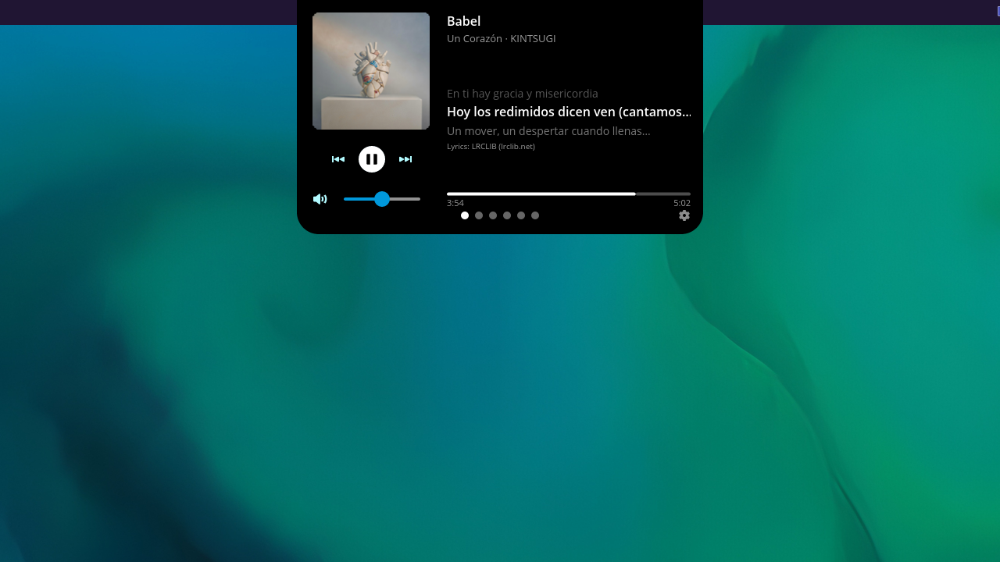
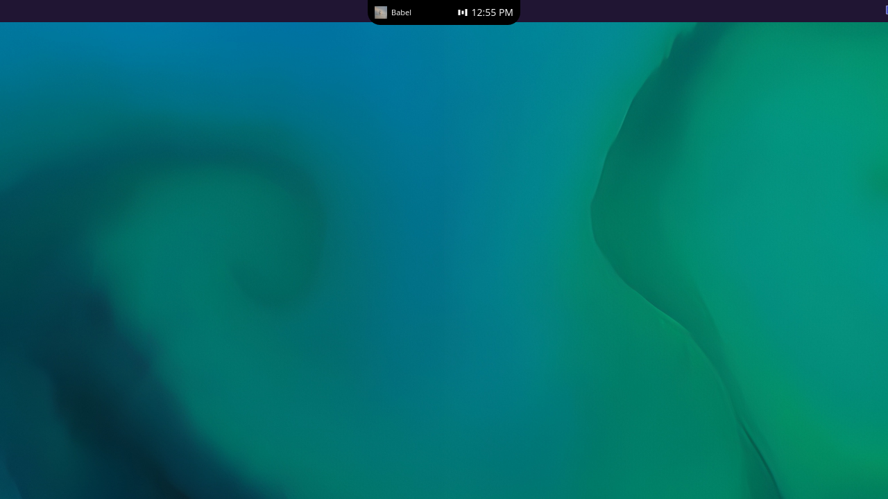
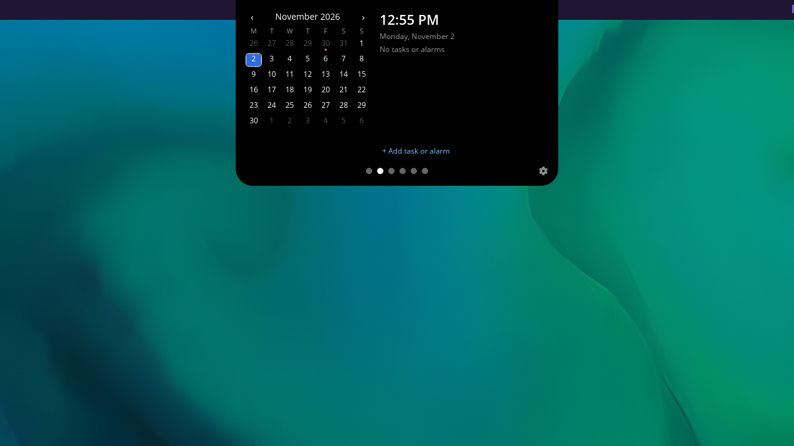
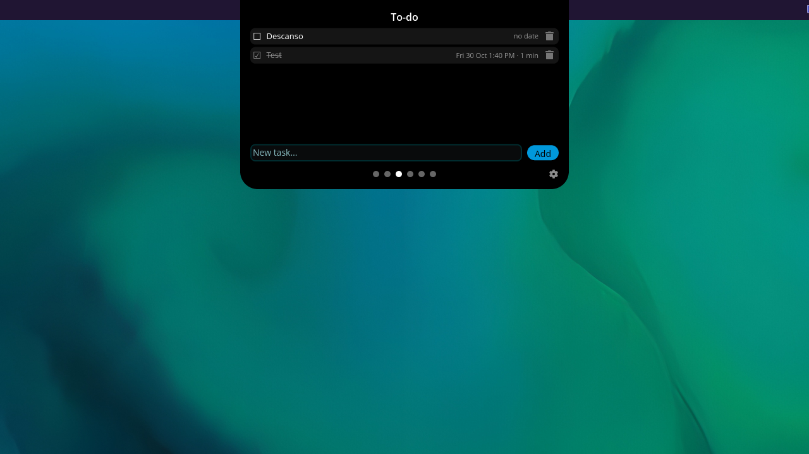
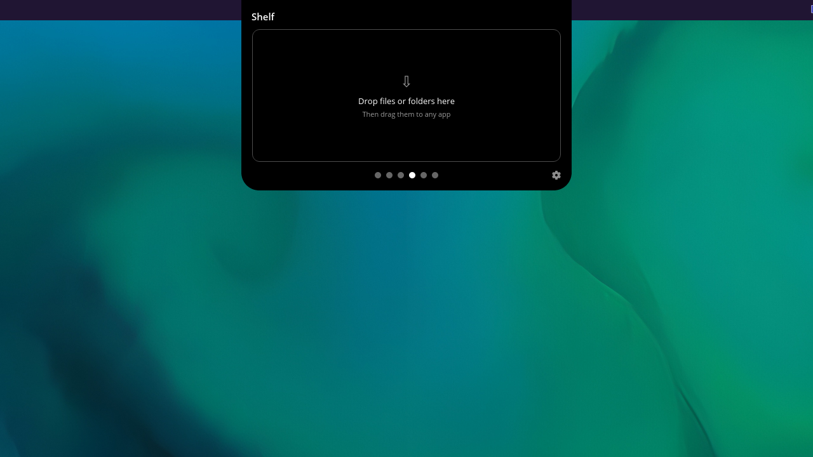
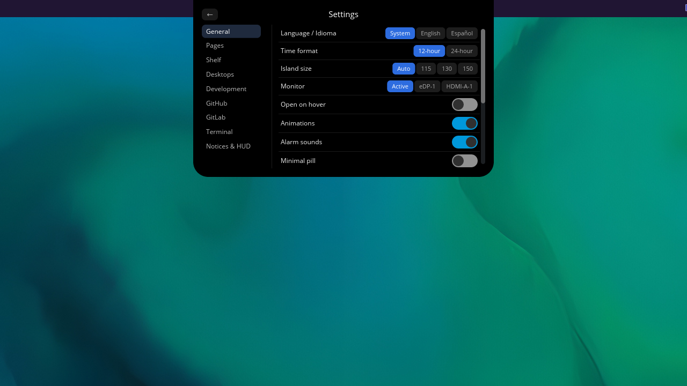

# Morph

[English](README.md) | [Español](README.es.md)

Morph es una isla dinámica para el escritorio [COSMIC](https://system76.com/cosmic) (Wayland). Es una pastilla discreta en la parte superior de la pantalla que muestra la hora o la música que suena, y se expande en una isla con páginas rápidas de música, calendario, tareas, archivos, escritorios y herramientas de desarrollo.

> Antes se llamaba Isla.



| | |
|---|---|
|  |  |
|  |  |
|  | |

## Funciones

- **La pastilla**: muestra la hora, o la canción actual si suena música. Al pasar el mouse muestra batería, RAM, CPU y volumen.
- **La isla**: se expande en páginas:
  - **Música**: controles para cualquier reproductor MPRIS, con letras sincronizadas de [LRCLIB](https://lrclib.net).
  - **Calendario** y **Tareas**, con alarmas.
  - **Shelf**: una bandeja para arrastrar y soltar archivos mientras los mueves.
  - **Escritorios**: espacios de trabajo y apps fijadas.
  - **Dev** (desactivada por defecto): servidores locales y puertos, PRs y Actions de GitHub mediante `gh`, merge requests y pipelines de GitLab con un token guardado en el llavero del sistema.
- **Terminal desplegable**: `morph --terminal`.
- **HUD y avisos**: HUD de volumen y brillo, más avisos de batería, Wi-Fi y Bluetooth.
- **Ubicación**: se arrastra por el borde superior o inferior, se oculta como una línea delgada o se coloca a nivel del panel.
- **Panel de ajustes**: inglés/español, reloj de 12/24 h y más.

## Requisitos

- Escritorio COSMIC en Wayland (por ejemplo Pop!_OS 24.04 con COSMIC).
- Opcional: `gh` (integración con GitHub en la página Dev), `pulseaudio-utils` o `pipewire-pulse` y `wireplumber` (volumen), un llavero Secret Service como `gnome-keyring` (token de GitLab).

## Instalación

### Instalar con apt (recomendado)

En Pop!_OS y Ubuntu las versiones nuevas llegan con un simple `sudo apt upgrade`:

```sh
sudo install -d -m 0755 /etc/apt/keyrings
sudo curl -fsSL https://jamthebest.github.io/morph/morph-archive-keyring.gpg -o /etc/apt/keyrings/morph.gpg
sudo tee /etc/apt/sources.list.d/morph.sources >/dev/null <<'EOF'
Types: deb
URIs: https://jamthebest.github.io/morph
Suites: stable
Components: main
Architectures: amd64
Signed-By: /etc/apt/keyrings/morph.gpg
EOF
sudo apt update && sudo apt install morph
```

Instalar el `.deb` de las Releases (abajo) también añade este repositorio automáticamente.

### Desde una release (.deb)

Descarga `morph_<versión>_<arq>.deb` y `SHA256SUMS` desde la página de [Releases](https://github.com/jamthebest/morph/releases) y ejecuta:

```sh
sha256sum -c SHA256SUMS --ignore-missing
sudo apt install ./morph_<versión>_<arq>.deb
```

### Desde el código

Necesitas Rust 1.93 o superior, [`just`](https://github.com/casey/just) y los paquetes de desarrollo de libcosmic:

```sh
sudo apt install build-essential cmake just pkg-config libxkbcommon-dev libwayland-dev \
  libudev-dev libinput-dev libfontconfig-dev libfreetype-dev libexpat1-dev libdbus-1-dev
just install     # instala en ~/.local
```

Asegúrate de que `~/.local/bin` esté en tu `PATH`. Otras recetas: `just deb` genera `dist/morph_<versión>_<arq>.deb`, `just licenses` regenera `THIRD-PARTY-LICENSES.md`.

### Autoinicio

Activa el interruptor de autoinicio en los ajustes de Morph. El instalador no lo activa por ti.

## Desinstalación

- `.deb` / apt: `sudo apt remove morph`. Si añadiste el repositorio a mano, borra también `/etc/apt/sources.list.d/morph.sources` y `/etc/apt/keyrings/morph.gpg` (el `.deb` elimina su propia copia con `sudo apt purge morph`).
- `just install`: `just uninstall`

Ninguno borra tu configuración ni tus datos. Para eliminarlos:

```sh
rm -rf ~/.config/cosmic/io.github.jamthebest.Morph ~/.local/share/morph
rm -f ~/.config/autostart/io.github.jamthebest.Morph.desktop
```

Las versiones antiguas guardaban los ajustes en `~/.config/cosmic/dev.jam.Morph` y `~/.config/cosmic/dev.jam.Isla`; Morph los copia en el primer arranque y los deja en su sitio, así que puedes borrarlos a mano.

Si guardaste un token de GitLab, olvídalo antes en Ajustes → GitLab (o borra la entrada `io.github.jamthebest.Morph` de tu llavero).

## Uso

Todo se configura desde el panel de ajustes (`morph --settings`).

| Comando | Qué hace |
| --- | --- |
| `morph` | Inicia Morph (instancia única). |
| `morph --toggle` | Abre o cierra la isla que ya corre. |
| `morph --page <nombre>` | Abre una página: `musica`, `calendario`, `todo`, `shelf`, `escritorios`, `dev` (también valen los nombres en inglés). |
| `morph --terminal` | Muestra u oculta la terminal desplegable. |
| `morph --settings` | Abre el panel de ajustes. |

Asígnales atajos en *Ajustes de COSMIC → Teclado → Atajos personalizados*, por ejemplo `morph --toggle` en `Super+I`.

## Privacidad

Morph no tiene telemetría. Los únicos servicios externos que usa son:

- **LRCLIB** (`lrclib.net`): busca letras por título, artista y duración.
- **GitHub**: mediante tu propio `gh`, solo si activas la página Dev.
- **GitLab**: solo si lo activas; el token se guarda en el llavero del sistema, nunca en disco.

## Apoyar el proyecto

Morph es software libre. Si te resulta útil, puedes apoyarlo:

- [Ko-fi](https://ko-fi.com/jamthebest)
- [itch.io](https://jamthebest.itch.io/morph) (paga lo que quieras)

## Licencia

GPL-3.0-only. Consulta [LICENSE](LICENSE) y [THIRD-PARTY-LICENSES.md](THIRD-PARTY-LICENSES.md).
