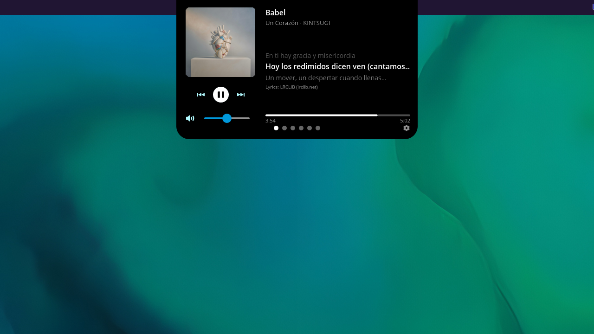
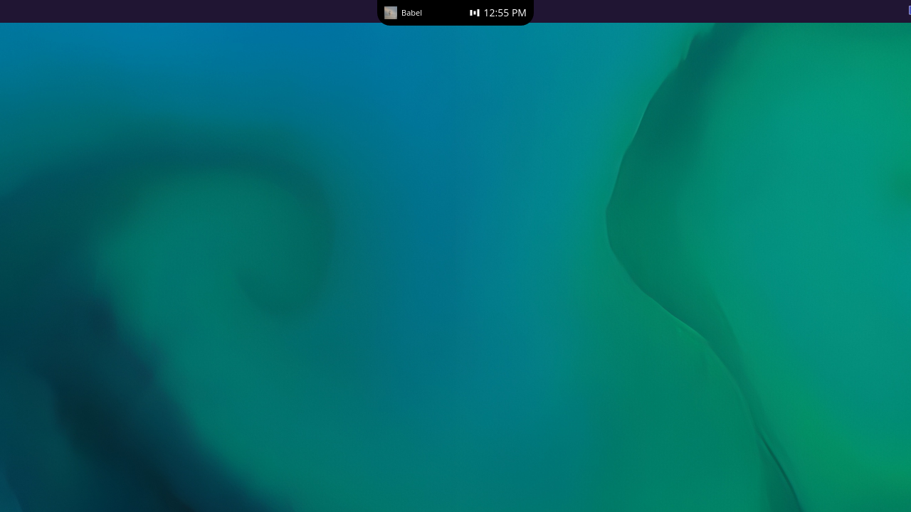
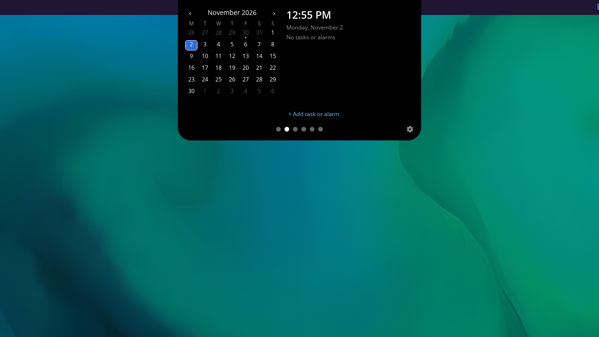
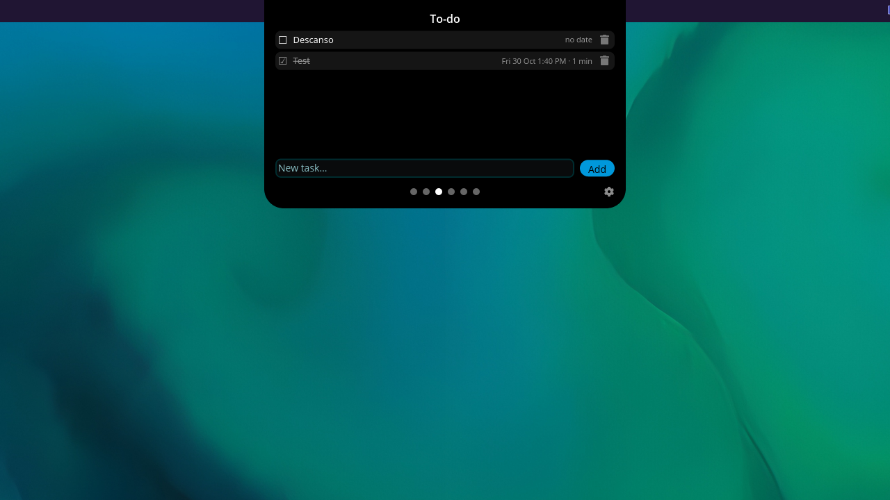
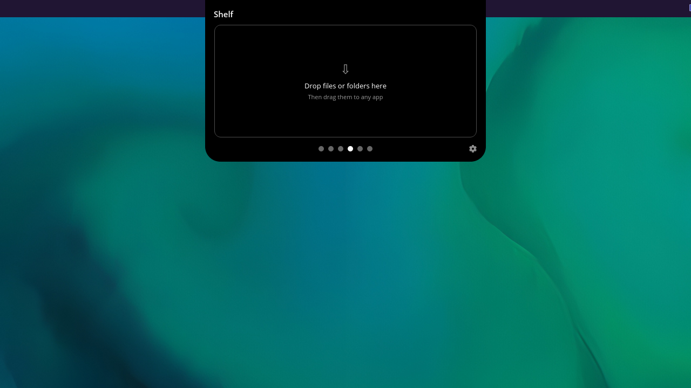
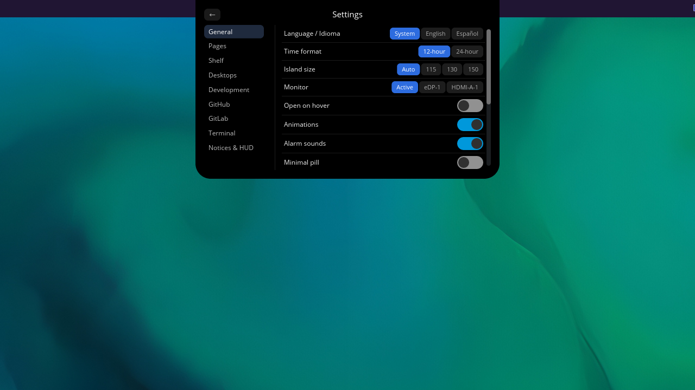

# Morph

[English](README.md) | [Español](README.es.md)

Morph is a dynamic island for the [COSMIC](https://system76.com/cosmic) desktop (Wayland). It is a discreet pill at the top of the screen that shows the clock or the music that is playing, and expands into an island with quick pages for music, calendar, to-dos, files, desktops and developer tools.

> Formerly called Isla.



| | |
|---|---|
|  |  |
|  |  |
|  | |

## Features

- **The pill**: shows the clock, or the current track when music is playing. Hover it to peek at battery, RAM, CPU and volume.
- **The island**: expands into pages:
  - **Music**: controls for any MPRIS player, with synced lyrics from [LRCLIB](https://lrclib.net).
  - **Calendar** and **To-do**, with alarms.
  - **Shelf**: a drag-and-drop tray to park files while you move them around.
  - **Desktops**: workspaces and pinned apps.
  - **Dev** (off by default): local servers and open ports, GitHub PRs and Actions through `gh`, GitLab merge requests and pipelines with a token kept in the system keyring.
- **Drop-down terminal**: `morph --terminal`.
- **HUD and notices**: volume and brightness HUD, plus battery, Wi-Fi and Bluetooth notices.
- **Placement**: drag it along the top or bottom edge, hide it as a thin line, or place it at panel level.
- **Settings panel**: English/Spanish, 12/24 h clock and more.

## Requirements

- COSMIC desktop on Wayland (for example Pop!_OS 24.04 with COSMIC).
- Optional: `gh` (GitHub integration in the Dev page), `pulseaudio-utils` or `pipewire-pulse` and `wireplumber` (volume), a Secret Service keyring such as `gnome-keyring` (GitLab token).

## Install

### From a release (.deb)

Download `morph_<version>_<arch>.deb` and `SHA256SUMS` from the [Releases](https://github.com/jamthebest/morph/releases) page, then:

```sh
sha256sum -c SHA256SUMS --ignore-missing
sudo apt install ./morph_<version>_<arch>.deb
```

### From source

You need Rust 1.93 or newer, [`just`](https://github.com/casey/just) and the development packages for libcosmic:

```sh
sudo apt install build-essential cmake just pkg-config libxkbcommon-dev libwayland-dev \
  libudev-dev libinput-dev libfontconfig-dev libfreetype-dev libexpat1-dev libdbus-1-dev
just install     # installs into ~/.local
```

Make sure `~/.local/bin` is in your `PATH`. Other recipes: `just deb` builds `dist/morph_<version>_<arch>.deb`, `just licenses` regenerates `THIRD-PARTY-LICENSES.md`.

### Autostart

Turn on the autostart switch in Morph's settings. The installer does not enable it for you.

## Uninstall

- `.deb`: `sudo apt remove morph`
- `just install`: `just uninstall`

Neither removes your configuration or data. To delete them:

```sh
rm -rf ~/.config/cosmic/dev.jam.Morph ~/.local/share/morph
rm -f ~/.config/autostart/dev.jam.Morph.desktop
```

If you saved a GitLab token, forget it first in Settings → GitLab (or remove the `dev.jam.Morph` entry from your keyring).

## Usage

Everything is configurable from the settings panel (`morph --settings`).

| Command | What it does |
| --- | --- |
| `morph` | Starts Morph (single instance). |
| `morph --toggle` | Opens or closes the running island. |
| `morph --page <name>` | Opens a page: `music`, `calendar`, `todo`, `shelf`, `desktops`, `dev`. |
| `morph --terminal` | Shows or hides the drop-down terminal. |
| `morph --settings` | Opens the settings panel. |

Bind them to keys in *COSMIC Settings → Keyboard → Custom shortcuts*, for example `morph --toggle` on `Super+I`.

## Privacy

Morph has no telemetry. The only external services it talks to are:

- **LRCLIB** (`lrclib.net`): looks up lyrics by track title, artist and duration.
- **GitHub**: through your own `gh` CLI, only if you enable the Dev page.
- **GitLab**: only if you enable it; the token is stored in the system keyring, never on disk.

## Support the project

Morph is free software. If it is useful to you, you can support it:

- [Ko-fi](https://ko-fi.com/jamthebest)
- [itch.io](https://jamthebest.itch.io/morph) (pay what you want)

## License

GPL-3.0-only. See [LICENSE](LICENSE) and [THIRD-PARTY-LICENSES.md](THIRD-PARTY-LICENSES.md).
